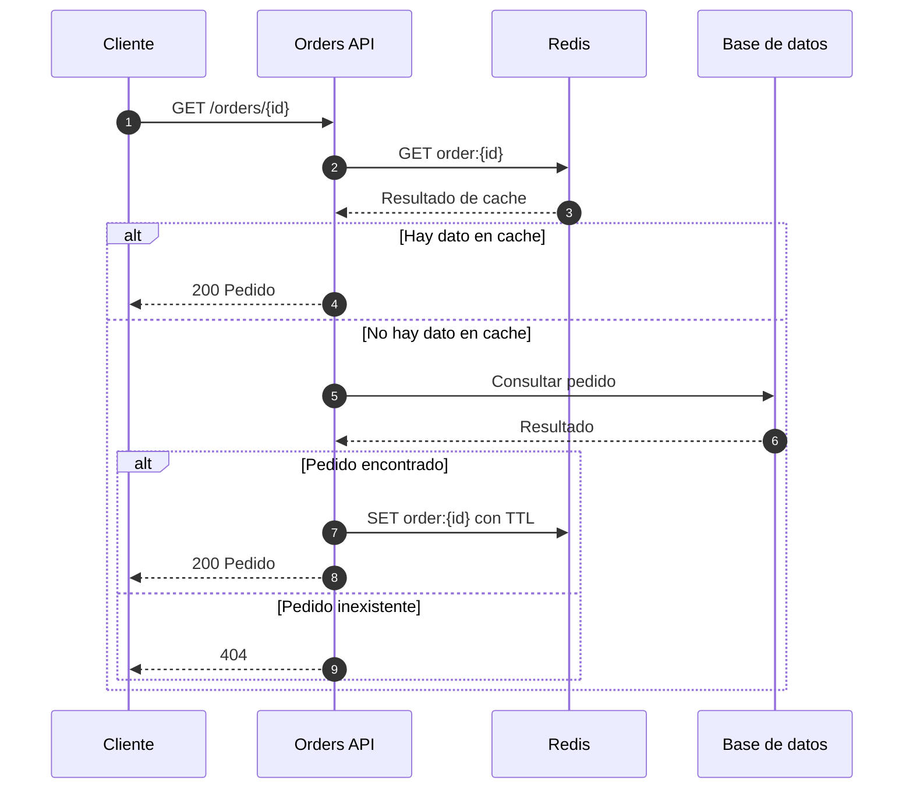

# Contrato de entregables

```text
docs/archiflow-scan/<servicio>/
  analysis.md
  coverage.csv
  evidence.csv
  progress.md
  architecture.mmd
  flows/
    <flow-id>.md
    <flow-id>.sequence.mmd
  drawio/
    publication.md
```

Escribe `.drawio` solo si se generó o recuperó XML válido; una URL no equivale a archivo guardado. `drawio/` se necesita solo cuando se pidió integración. Los flowcharts adicionales por entrada son opcionales.

## Documentación

`analysis.md` registra alcance, fecha, revisión/configuración, propósito, responsabilidades, límites, entradas, dependencias, datos, eventos, excepciones, discrepancias OpenAPI y cobertura. Distingue hechos técnicos de interpretación de negocio. Explica límites del descubrimiento y frameworks no soportados.

Cada `<flow-id>.md` explica disparador, precondiciones, resultado, efectos secundarios, secuencia con evidencia, alternativas, concurrencia, bucles, retornos, errores, retry/fallback, transacciones, integraciones y desconocidos. Documenta los escenarios cubiertos sin prometer enumeración exhaustiva de combinaciones.

## Inventarios estándar

CSV UTF-8 con encabezados y escape estándar:

- `coverage.csv`: `entry_id,kind,method,route_or_trigger,handler,status,flow_id,reason`.
- `evidence.csv`: `evidence_id,flow_id,diagram_element_id,claim,status,file,line_start,line_end,symbol,source_detail`.

Estas columnas son inventario, no un lenguaje de flujos. `source_detail` permite fuentes de contrato/configuración/traza; deja líneas vacías si no aplican. No inventes campos. Usa rutas relativas a la raíz registrada para portabilidad. Varias fuentes de una afirmación pueden ocupar varias filas.

Usa IDs estables derivados de método/ruta o trigger, con sufijo determinista ante colisiones. Verbos distintos son entradas distintas. Eventos/jobs no llevan un método HTTP inventado. Explica entradas excluidas, como health checks. Evita porcentajes arbitrarios de confianza.

## Mermaid

- `flowchart LR` representa dependencias: agrupa servicios y separa caché, almacenamiento y broker. Etiqueta operación/protocolo y marca conexiones condicionadas o inferidas.
- `sequenceDiagram` con `autonumber` explica cada entrada. Usa `alt/else`, `opt`, `par/and` y `loop` cuando haya evidencia.
- Distingue solicitudes, respuestas y mensajes asíncronos. Una flecha discontinua por sí sola no significa publicación: etiqueta el evento explícitamente.
- Conserva los errores relevantes en la vista o en un escenario enlazado. No elimines ramas para embellecer el diagrama.
- Añade evidencia con comentarios `%%` o notas breves; conserva el detalle en la tabla externa. No presupongas que la conversión a Draw.io preserva IDs de Mermaid como IDs de celdas.
- La posición de cajas en el mapa general no prueba orden de ejecución.

Ejemplo hipotético; no representa código analizado:



En un análisis real, incluye APIs remotas, tópicos, errores y orden únicamente donde el código los respalde. No copies este patrón cache-aside ni el TTL como comportamiento predeterminado.
